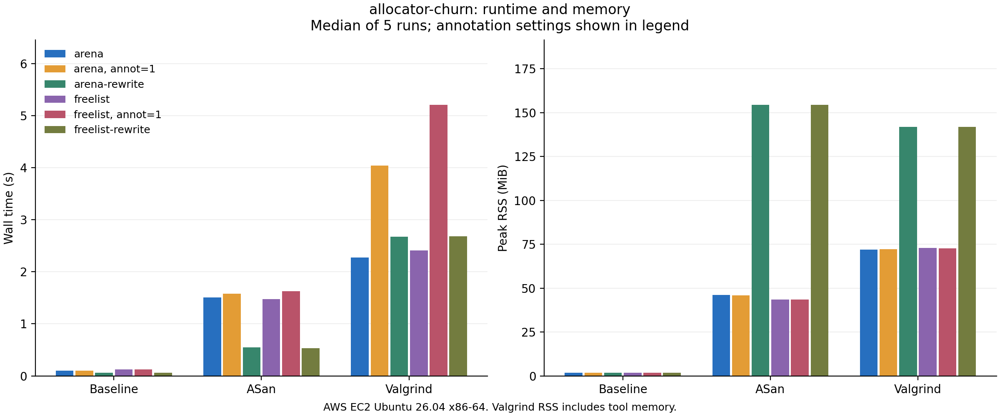

# Part B: CMA implementation, annotations and Q1

## CMA implementations

The constructed corpus calls one `st_alloc` interface. The malloc baseline
delegates every object to libc. Arena carves 16-byte-aligned objects from a
single backing block and never reuses an individually freed object. Its
external side table records requested size and liveness so annotation can
close each object's addressable range, and `realloc` copies into a new slot.
The Free list uses 32, 64, 128 and 256-byte classes, plus non-recycled larger
slots, all within one backing block. Freeing a class slot immediately puts it
at the head of a LIFO list. Bookkeeping for the next free slot occupies the
slot only while it is free.

SQLite provides two additional CMA layers for the constructed
corpus. memsys5 uses a single supplied heap and power-of-two buddy blocks;
lookaside uses 128-byte slots owned by an in-memory database connection.
Requests too large for lookaside fall back to SQLite's global allocator. A
direct contract check confirmed a lookaside hit and immediate slot reuse.
The adapter uses SQLite 3.53.3; the real-bug corpus uses 3.22.0 and C's
`speedtest1` benchmark uses 3.50.4. Their measurements are labelled by
version and are not pooled.

The final Part B measurements ran from commit `2763402` on an AWS EC2
Ubuntu 26.04 x86-64 instance (2-vCPU Intel Xeon Platinum 8259CL,
Linux 7.0.0-1006-aws). The tools were clang/ASan 21.1.8 and Valgrind
3.26.0. This is a different machine from C's VirtualBox benchmark VM.
Four detection bundles contain 704 CSV rows: 352 bug images paired with
352 negative controls. Both tools passed the malloc overflow and UAF
positive controls before each matrix. Every negative control was CLEAN.
The exact environment, verdicts and raw diagnostics are in the immutable
[Part B results](../results/README.md).

## Boundary annotations

`ST_ANNOT=1` changes annotation calls in Arena and Free list. ASan
poisons the backing block, unpoisons exactly the requested bytes at allocation
and re-poisons at free. Memcheck's mempool requests describe each logical
allocation and free. The Free list temporarily opens the in-slot next link
while maintaining its list. Both allocators have clean negative controls in
the formal EC2 matrix. The generated memsys5 patch applies the same
idea to SQLite buddy blocks and temporarily opens free-list links. The
`st_alloc` adapter tracks exact requests to close memsys5's rounded slack.
Lookaside has no verified annotation patch; its `ANNOT=1` build is rejected.
In the EC2 matrix, memsys5 annotation raised detection from 1/16 to 11/16
under ASan and from 2/16 to 14/16 under Valgrind. The unannotated
lookaside arm detected 1/16 under ASan and 2/16 under Valgrind. Every
negative control remained CLEAN.

The table reports DETECTED / eligible bug images; `UNSUPPORTED`
preconditions are excluded from the denominator. Each row has 16 CLEAN
negative controls. The duplicate `malloc, ANNOT=1` build also ran and gave
the same results as `malloc, ANNOT=0`; malloc has no custom annotation hook.

| Tool | Allocator | Unannotated | Annotated |
|---|---|---:|---:|
| ASan | malloc baseline | 12/13 | 12/13 (same hook setting) |
| ASan | Arena | 1/14 | 10/14 |
| ASan | Free list | 1/16 | 11/16 |
| ASan | SQLite memsys5 | 1/16 | 11/16 |
| ASan | SQLite lookaside | 1/16 | not implemented |
| Valgrind | malloc baseline | 13/13 | 13/13 (same hook setting) |
| Valgrind | Arena | 2/14 | 13/14 |
| Valgrind | Free list | 2/16 | 14/16 |
| Valgrind | SQLite memsys5 | 2/16 | 14/16 |
| Valgrind | SQLite lookaside | 2/16 | not implemented |

Arena's two unsupported cases require immediate slot reuse, which it never
provides. malloc's three unsupported cases require reuse or bulk pool
destruction. Unannotated CMA successes mostly detect the outer backing
block, not logical object boundaries. Case 12 reads after the whole pool
is freed; Valgrind also reports the far-outside-pool read in case 4. On
this EC2 host ASan prints `SEGV on unknown address` for case 4 under
Arena and Free list (both annotation settings), unannotated memsys5 and
lookaside, without a heap-boundary diagnosis. Annotated memsys5 simply
misses case 4 without that signal. The classifier records signal-only
crashes as `MISSED crashed SEGV`; a crash alone is not credited as
detection. This host-dependent outcome explains why Arena and Free-list
ASan counts are one lower than in arm64 development checks.

## Rewrite and Q1 interpretation

The two 14-line rewrite arms replace pool operations with libc
`malloc`/`free`/`realloc`. They expose each object to ASan and Memcheck, but
change reuse, reclamation and pool-destruction semantics. A detected overflow
or UAF in a rewrite arm shows that the detector sees a libc object boundary;
it does not show that it understood the original CMA. Cases whose defining
event disappears are `UNSUPPORTED`, not `MISSED` or `DETECTED`.

In the formal EC2 matrix, each rewrite detected 12/13 eligible bugs under
ASan and 13/13 under Valgrind. Each had three `UNSUPPORTED` cases and
16 CLEAN negative controls. Case 3 remains MISSED under ASan because the
bad write lands in another live libc object. Cases 10, 12 and 15 lose
the required immediate reuse or bulk-pool destruction under rewrite.
The per-case semantics and implementation tradeoffs are documented in
[cma-rewrite.md](../docs/cma-rewrite.md).

The mechanism explains the remaining gaps. A write that lands in another
live object is addressable even when both object bounds are annotated (case
3). After a Free-list slot is reissued, the old and new pointers have the
same address, so ASan and Memcheck cannot identify the old owner (case 10).
ASan's poisoning API has no free-ownership event, leaving double and
interior frees invisible when they do not access poisoned bytes (cases 13
and 14). Memcheck's mempool ownership requests detect those frees. A
whole-pool free is detected even without per-object annotations because the
single underlying malloc block itself ends (case 12); that result must not
be credited as CMA-aware detection.

## Annotation overhead and rewrite tradeoff

The [allocator-churn bundle](../results/2026-11-10-allocator-churn-IkUTIU/benchmark.csv)
runs the same 10,000-cycle allocation/reuse workload five times for each
configuration, sequentially on EC2. Times are median high-resolution
workload wall seconds; peak RSS is the median of `/usr/bin/time` readings.
The ratio compares `ANNOT=1` to `ANNOT=0` within the same allocator and
tool. `none` is an uninstrumented build control, where annotation calls
compile to no-ops.

| Allocator | Tool | Off (s) | On (s) | On / off | Off / on peak RSS (MiB) |
|---|---|---:|---:|---:|---:|
| Arena | ASan | 1.510 | 1.582 | 1.05× | 46.1 / 46.0 |
| Arena | Valgrind | 2.273 | 4.038 | 1.78× | 72.0 / 72.3 |
| Free list | ASan | 1.478 | 1.625 | 1.10× | 43.6 / 43.6 |
| Free list | Valgrind | 2.413 | 5.209 | 2.16× | 72.9 / 72.8 |

The [five-run summary](tables/part-b-churn-summary.csv) and
[PDF figure](figures/part-b-churn-performance.pdf) accompany the raw CSV.
The figure includes the uninstrumented and rewrite configurations.

Under ASan the rewrite medians were 0.547 s for Arena and 0.535 s for
Free list, with about 154 MiB peak RSS in both. Under Valgrind they were
2.672 and 2.686 s, with about 142 MiB peak RSS. The rewrite changes the
allocation algorithm and lifecycle, so these numbers describe a workload
tradeoff rather than the isolated cost of annotation. These EC2 times
cannot be numerically combined with C's VirtualBox SQLite `speedtest1`
times: the hardware and workloads differ.

The 16-case corpus supports the Q1 mechanism: a CMA hides internal object
boundaries from default ASan and Memcheck, while explicit boundary and
ownership annotations recover many detections. Neither approach recovers
provenance once a stale address is valid for a new object, and rewriting
can erase the reuse or bulk-free behavior under study. Transfer to real
SQLite bugs must be assessed separately with A's real-bug corpus.
